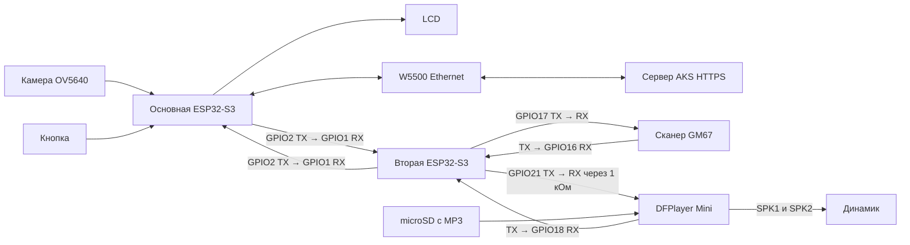

# Озвучка: вторая ESP32-S3, DFPlayer Mini и GM67

Основная плата сохраняет камеру, LCD, кнопку и прямой HTTPS к AKS.
На вторую ESP32-S3 переносится GM67; она же управляет **DFPlayer Mini
(DFR0299)** с microSD и динамиком. Интернет для воспроизведения не нужен.
DFPlayer имеет встроенный усилитель: отдельный I2S-усилитель в этой схеме
не требуется. Микрофон не используется.



У всех модулей общий GND. DFPlayer и GM67 питаются от 5 В; UART между
ESP32 — только 3,3 В. Выход динамика SPK1/SPK2 не соединяется с GND.

Используйте вторую **ESP32-S3 с выведенными GPIO1, 2, 16, 17, 18, 21 и
нативным USB**. В этой прошивке все три UART заняты; Serial Monitor идёт
через встроенный USB, не через USB-UART/CH343. PSRAM второй плате не нужна.

## Подключение при выключенном питании

Сначала снимите провода GM67 с GPIO1/2 основной платы.

| Основная ESP32-S3 | Вторая ESP32-S3 |
|---|---|
| GPIO2 — TX | GPIO1 — RX |
| GPIO1 — RX | GPIO2 — TX |
| GND | GND |

UART между платами: 115200, 8N1, логика **3,3 В**. Для макета используйте
короткие провода и общую землю. Не соединяйте выходы TX между собой.

| GM67 | Вторая ESP32-S3 |
|---|---|
| TX | GPIO16 — RX, UART2 |
| RX | GPIO17 — TX, UART2 |
| GND | GND |
| Питание 5V | Стабилизированное питание 5 В |

Сканер остаётся в ранее настроенном Continuous / UART / 9600 / ASCII
режиме. Прошивка принимает данные пассивно, без команд изменения режима.
Если TX конкретного GM67 выдаёт 5 В, нужен преобразователь уровня на его
линии TX → GPIO16. На GPIO ESP32 подавать 5 В нельзя.

| DFPlayer Mini | Вторая ESP32-S3 / питание |
|---|---|
| RX | GPIO21 — TX, UART0, через последовательный резистор 1 кОм |
| TX | GPIO18 — RX, UART0 (DFPlayer с логикой 3,3 В) |
| VCC | Стабилизированное питание 5 В |
| GND | Общий GND |
| SPK1, SPK2 | Два вывода динамика 4–8 Ом, до 3 Вт |

Динамик подключается **между SPK1 и SPK2**, ни один его провод не подключайте
к GND. Не питайте динамик/DFPlayer/GM67 от вывода 3V3 ESP32. Подберите
питание с запасом на обе платы, сканер и усилитель. При раздельном питании
плат достаточно общей земли, соединять их выводы 5V между собой не нужно.

Документация производителя: [DFPlayer DFR0299](https://wiki.dfrobot.com/dfr0299),
[команды и примеры](https://wiki.dfrobot.com/dfr0299/docs/20905).

## Записи на microSD

Карта FAT16/FAT32, до 32 ГБ. Создайте папку `mp3` в корне и положите туда
свои записи. Имена файлов — строго четыре цифры с расширением `.mp3`:

| Файл | Когда играет | Предлагаемый текст на азербайджанском |
|---|---|---|
| `mp3/0001.mp3` | Перед съёмкой | Kameraya baxın. |
| `mp3/0002.mp3` | Ожидание AKS | Yoxlanılır. Zəhmət olmasa, gözləyin. |
| `mp3/0003.mp3` | Лицо подтверждено | Şəxsiyyət təsdiqləndi. Barkodu skan edin. |
| `mp3/0004.mp3` | AKS отказал | Giriş qadağandır. |
| `mp3/0005.mp3` | Сбой связи | Serverlə əlaqə yoxdur. |
| `mp3/0006.mp3` | AKS подтвердил запись груза | Məlumat yadda saxlanıldı. |
| `mp3/0007.mp3` | Камера, HTTP-ошибка или узел сканера недоступен | Sistem xətası. |
| `mp3/0008.mp3` | Время сканирования истекло | Vaxt bitdi. Yenidən cəhd edin. |
| `mp3/0009.mp3` | Отмена кнопкой | Yoxlama ləğv edildi. |

Аудиофайлы **не созданы и не включены в репозиторий**: запишите фразы или
подготовьте MP3 самостоятельно. Первая фраза должна быть короткой (около
1 секунды), потому что затем начинается проверка. Новая стадия заменяет
предыдущую запись: старый отказ/подсказка не воспроизводятся после смены
состояния. Громкость задаётся `AUDIO_PLAYER_VOLUME` (0–30), сейчас 20.
После включения DFPlayer получает 2 секунды на чтение карты.

## Сборка и прошивка

В терминале из папки `firmware`:

```powershell
# Основная плата через CH343; замените COM4 на её текущий порт.
pio run -e esp32s3cam_audio_uart -t upload --upload-port COM4

# Вторая ESP32-S3: обязательно её нативный USB; укажите её порт.
pio run -e audio_node_s3 -t upload --upload-port COM_SECOND
```

Если основная плата тоже подключена через нативный USB, используйте
`esp32s3cam_audio` вместо `esp32s3cam_audio_uart`.
Обычные `esp32s3cam`/`esp32s3cam_uart` сохраняют схему GM67 на основной
плате. После переноса проводов нужна именно сборка с `_audio`.

## Проверка на стенде

1. Включите обе платы, дождитесь загрузки DFPlayer и сканера.
2. На второй плате откройте `pio device monitor -p COM_SECOND -b 115200`.
   Она выводит `[audio] ESP32-S3 companion`, а при команде —
   `play /mp3/0001.mp3 (command sent)`. Это подтверждает отправку команды,
   но не наличие карты, динамика или слышимого звука: проверьте их отдельно.
3. Нажмите кнопку основной платы: должны прозвучать приглашение и проверка.
4. После успешного ответа AKS прозвучит просьба отсканировать штрихкод.
   Только теперь поднесите код. После подтверждения записи AKS — фраза 0006.
5. Код, отсканированный до распознавания, не должен попасть в журнал.
6. Удержание кнопки при ожидании кода отменяет проверку с фразой 0009.
7. Без второй платы сканирование должно закончиться ошибкой, не записью.

Между платами передаются номера фраз и штрихкоды. Фото, имена и API-ключ
на вторую ESP32 не передаются. CRC16 отбрасывает повреждённые UART-кадры;
новый случайный идентификатор проверки не позволяет принять старый код.
Команда ARM отправляется только после `matched=true`; код подтверждается
STOP_SCAN, до подтверждения узел повторяет его. При перезагрузке узла ARM
повторяется с оставшимся временем, без продления окна основной платы.

На реальном оборудовании озвучку нужно проверить после сборки схемы.
Сами прошивки можно собрать без подключённых плат.
